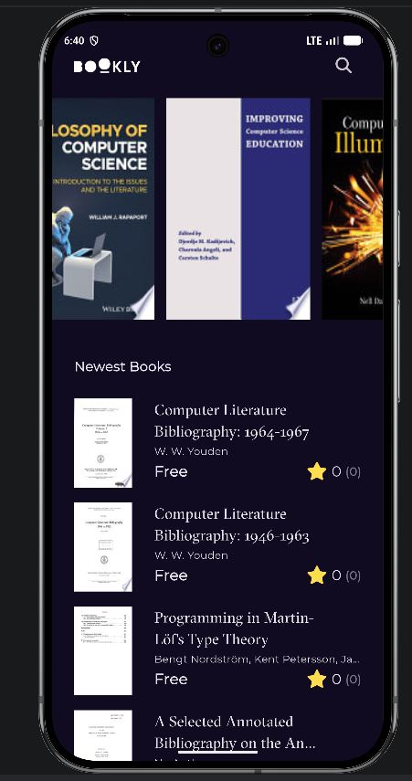

<div align="center">

# 📚 Bookly App

A Flutter mobile application for discovering, browsing, and previewing books using the **Google Books API**.


</div>

---

## 🚀 Getting Started

**Bookly** is a Flutter application designed for managing reading lists and discovering new books.
It consumes the **Google Books API** and presents books in a clean, dark-themed UI with a simple and smooth user experience.

---

## ✨ Features

- Browse **Featured Books**.
- Explore **Newest Books**.
- View **Book Details**.
- Open **Free Preview** links.
- See **Similar Books** suggestions.
- Smooth, modern **dark UI**.
- Built with **Cubit / BLoC** for state management.

---

## 🧠 Learning

During this project, I practiced and improved my skills in:

- **MVVM / Feature-First Architecture**
- **Cubit / BLoC** state management
- **Dio** for API integration
- **GetIt** for dependency injection
- **GoRouter** for navigation
- **Dartz** for functional error handling
- **CachedNetworkImage** for efficient image loading
- Building reusable and clean Flutter UI components

---

## 📱 UI

<div align="center">
  
  
  
</div>

<br>

<div align="center">
  <b>Splash Screen</b> • <b>Home Screen</b> • <b>Book Details</b>
</div>

---

## 🎬 Demo Video

> Add your demo video here after uploading it to GitHub or attaching it in the repository.

```md
[Demo Video](assets/readme/bookly-app.mp4)
```

Or if you upload it in the README assets section, you can show it like this:

```html
https://github.com/user-attachments/assets/your-video-link-here
```

---

## 🏗 Architecture

```text
lib/
├── core/
│   ├── errors/
│   ├── utils/
│   └── widgets/
├── features/
│   ├── home/
│   │   ├── data/
│   │   └── presentation/
│   ├── search/
│   └── splash/
├── constants.dart
└── main.dart
```

---

## 🛠 Dependencies

```yaml
dependencies:
  flutter:
    sdk: flutter
  cupertino_icons: ^1.0.8
  dartz: ^0.10.1
  dio: ^5.11.1
  equatable: ^3.0.0
  flutter_bloc: ^9.1.1
  font_awesome_flutter: ^11.0.0
  go_router: ^17.5.0
  google_fonts: 8.2.1
  get_it: ^9.3.0
  cached_network_image: ^3.4.1
  url_launcher: ^6.3.3
```

---

## ▶️ Run Locally

```bash
git clone https://github.com/Abraamehab2005/Bookly.git
cd Bookly
flutter pub get
flutter run
```

---

## 📌 Notes

- The app depends on the **Google Books API**.
- API quota limits may affect loading in some cases.
- You can improve the README further by adding a **GIF** or **screen recording** of the app.

---

<div align="center">

### Made with ❤️ using Flutter

</div>
